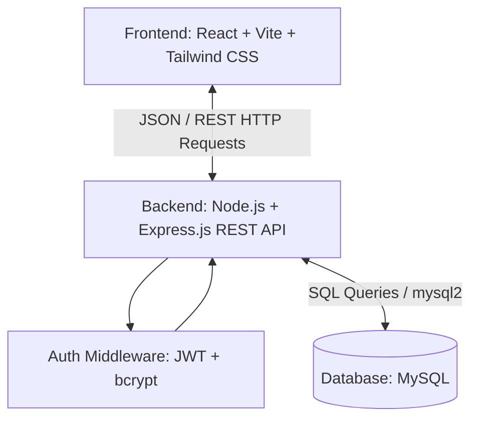
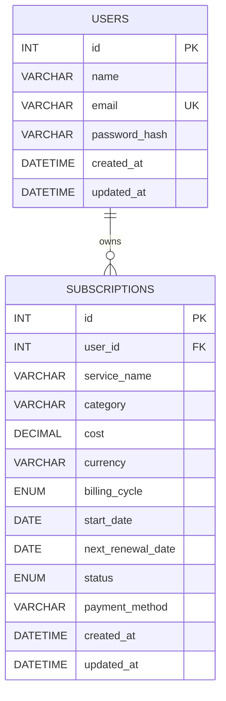

# 🔄 SubFlow – Subscription Management System

[](https://reactjs.org/)
[](https://vitejs.dev/)
[](https://tailwindcss.com/)
[](https://nodejs.org/)
[](https://expressjs.com/)
[](https://www.mysql.com/)
[](https://jwt.io/)

> **A streamlined, full-stack web application designed to help users track, manage, and optimize recurring subscriptions, monitor upcoming renewals, and take control of recurring expenses.**

---

## 📌 Table of Contents

- [Problem Statement & Proposed Solution](#-problem-statement--proposed-solution)
- [System Architecture & Tech Stack](#-system-architecture--tech-stack)
- [Features & Modules](#-features--modules)
  - [Completed (MVP)](#-completed-features-mvp)
  - [Planned Enhancements](#-planned-features-roadmap)
- [Project Folder Structure](#-project-folder-structure)
- [Database Overview](#-database-overview)
- [Getting Started & Installation](#-getting-started--installation)
- [Environment Configuration](#-environment-configuration)
- [API Documentation](#-api-documentation)
- [Team Contributions](#-team-contributions)
- [Future Enhancements](#-future-enhancements)
- [License](#-license)

---

## 💡 Problem Statement & Proposed Solution

### The Problem
In an increasingly subscription-driven economy (streaming, SaaS, cloud storage, fitness, memberships), individuals routinely subscribe to multiple services across personal and professional domains. Users face:
- **Subscription Sprawl & Hidden Costs:** Difficulty in tracking recurring monthly/annual expenditures.
- **Unintended Renewals:** Unwanted credit card charges resulting from missed trial end dates and renewal deadlines.
- **Fragmented Records:** Scattered receipts across disparate email accounts and banking portals without a centralized financial dashboard.

### The Proposed Solution
**SubFlow** provides an intuitive, centralized dashboard where users can catalog their active subscriptions, analyze monthly/yearly spending breakdowns, receive alerts on upcoming payment deadlines, and make informed financial decisions to curb unwanted digital recurring expenses.

---

## 🛠 System Architecture & Tech Stack



| Domain | Technology | Description |
| :--- | :--- | :--- |
| **Frontend UI** | [React 18](https://react.dev/) + [Vite](https://vitejs.dev/) | High-performance SPA with fast HMR |
| **Styling** | [Tailwind CSS](https://tailwindcss.com/) | Modern utility-first responsive styling |
| **Backend Runtime** | [Node.js](https://nodejs.org/) & [Express.js](https://expressjs.com/) | RESTful API server and request routing |
| **Database** | [MySQL 8.0+](https://www.mysql.com/) | Relational database for transactional integrity |
| **Authentication** | [JSON Web Tokens (JWT)](https://jwt.io/) + [bcrypt](https://www.npmjs.com/package/bcrypt) | Stateless token auth and salt-hashed password storage |
| **HTTP Client** | [Axios](https://axios-http.com/) | Promise-based client for API communication |

---

## 🚀 Features & Modules

### ✅ Completed Features (MVP)
The following core capabilities are currently implemented and ready for evaluation:

#### 1. Authentication & Session Security
- User registration with email validation and unique account checking.
- Password hashing utilizing `bcrypt` (10 salt rounds).
- Stateless authentication issuing signed JWT tokens stored securely on the client.
- Protected API routes verified via Express authorization middleware.

#### 2. Subscription Management (CRUD)
- **Create:** Add new subscriptions specifying name, category, billing cycle, cost, currency, next renewal date, and payment method.
- **Read:** View active and cancelled subscriptions with real-time status badges.
- **Update:** Edit existing subscription parameters (price changes, cycle adjustments).
- **Delete:** Soft/hard delete unwanted or obsolete subscription records.

#### 3. Analytics & Overview Dashboard
- Aggregated financial summary card: Total Monthly Spend & Total Annualized Spend.
- Active subscriptions counter and category breakdown.
- Upcoming renewals list highlighting subscriptions due within the next 7 to 30 days.

---

### ⏳ Planned Features (Roadmap)
The following features are designed and slated for future releases:

- 🔔 **Automated Email / SMS Reminders:** Integration with SendGrid / Nodemailer to send renewal alerts 3 days prior to charge date.
- 💳 **Banking Integration / Plaid:** Automatic detection of recurring charges from bank feeds.
- 📊 **Historical Spend Charts:** Interactive charts showing month-over-month expenditure trends using Chart.js.
- 💱 **Multi-Currency Converter:** Automatic real-time currency conversion to user's home currency.
- 📄 **Export Reports:** Download subscription breakdowns in CSV/PDF formats for expense reporting.

---

## 📂 Project Folder Structure

```text
SubSphere/
├── client/                     # Frontend Application (React + Vite)
│   ├── public/                 # Static assets & icons
│   ├── src/
│   │   ├── assets/             # Images, SVGs, and branding
│   │   ├── components/         # Reusable UI components (Navbar, Modal, Cards)
│   │   │   ├── common/         # Buttons, Input fields, Badges
│   │   │   ├── dashboard/      # MetricsCard, RenewalList, SpendSummary
│   │   │   └── subscriptions/  # SubscriptionForm, SubscriptionTable
│   │   ├── context/            # React Context (AuthContext, ThemeContext)
│   │   ├── pages/              # View pages (Login, Register, Dashboard, Settings)
│   │   ├── services/           # Axios API service handlers
│   │   ├── utils/              # Formatting helpers (currency, date formatters)
│   │   ├── App.jsx             # Main routing component
│   │   ├── main.jsx            # React root mount point
│   │   └── index.css           # Tailwind CSS directives
│   ├── index.html              # HTML entry point
│   ├── package.json            # Frontend dependencies & scripts
│   ├── tailwind.config.js      # Tailwind CSS configuration
│   └── vite.config.js          # Vite build config
│
├── server/                     # Backend Application (Node.js + Express)
│   ├── src/
│   │   ├── config/             # Database connection pool setup (db.js)
│   │   ├── controllers/        # Request handling logic (auth, subscriptions)
│   │   ├── middleware/         # Auth verification (verifyToken.js), error handlers
│   │   ├── routes/             # Express API routing definitions
│   │   │   ├── authRoutes.js
│   │   │   └── subscriptionRoutes.js
│   │   └── server.js           # Server bootstrap and entry point
│   ├── database/
│   │   └── schema.sql          # MySQL database schema definition
│   ├── .env.example            # Backend environment template
│   └── package.json            # Backend dependencies & scripts
│
├── .gitignore                  # Git ignore rules for node_modules, .env, dist
└── README.md                   # Project documentation
```

---

## 🗄 Database Overview

The system uses a relational MySQL database designed with referential integrity and indexing on foreign keys for optimal query performance.



### Table Definitions

#### 1. `users` Table
| Column Name | Data Type | Constraints | Description |
| :--- | :--- | :--- | :--- |
| `id` | `INT` | `PRIMARY KEY AUTO_INCREMENT` | Unique user identifier |
| `name` | `VARCHAR(100)` | `NOT NULL` | Full name of the user |
| `email` | `VARCHAR(150)` | `NOT NULL, UNIQUE` | User login email address |
| `password_hash` | `VARCHAR(255)` | `NOT NULL` | Salted and hashed password |
| `created_at` | `TIMESTAMP` | `DEFAULT CURRENT_TIMESTAMP` | Account creation timestamp |
| `updated_at` | `TIMESTAMP` | `DEFAULT CURRENT_TIMESTAMP ON UPDATE CURRENT_TIMESTAMP` | Last profile update |

#### 2. `subscriptions` Table
| Column Name | Data Type | Constraints | Description |
| :--- | :--- | :--- | :--- |
| `id` | `INT` | `PRIMARY KEY AUTO_INCREMENT` | Unique subscription identifier |
| `user_id` | `INT` | `NOT NULL, FOREIGN KEY (users.id) ON DELETE CASCADE` | Owner user reference |
| `service_name` | `VARCHAR(100)` | `NOT NULL` | Name of service (e.g., Netflix, Spotify) |
| `category` | `VARCHAR(50)` | `NOT NULL` | Category (Entertainment, Work, Utility) |
| `cost` | `DECIMAL(10, 2)` | `NOT NULL` | Subscription cost |
| `currency` | `VARCHAR(3)` | `DEFAULT 'USD'` | 3-letter ISO currency code |
| `billing_cycle` | `ENUM` | `('monthly', 'yearly', 'quarterly', 'weekly')` | Billing recurrence |
| `start_date` | `DATE` | `NOT NULL` | Original subscription start date |
| `next_renewal_date`| `DATE` | `NOT NULL` | Next expected billing date |
| `status` | `ENUM` | `('active', 'paused', 'cancelled') DEFAULT 'active'` | Current status |
| `payment_method` | `VARCHAR(50)` | `NULL` | Card / PayPal / UPI reference |
| `created_at` | `TIMESTAMP` | `DEFAULT CURRENT_TIMESTAMP` | Entry creation time |
| `updated_at` | `TIMESTAMP` | `DEFAULT CURRENT_TIMESTAMP ON UPDATE CURRENT_TIMESTAMP` | Entry update time |

---

## ⚡ Getting Started & Installation

### Prerequisites
Make sure you have the following installed on your machine:
- **Node.js** (v18.x or higher) & **npm** (v9.x or higher) — [Download Node.js](https://nodejs.org/)
- **MySQL Server** (v8.0 or higher) — [Download MySQL](https://dev.mysql.com/downloads/)
- **Git** — [Download Git](https://git-scm.com/)

---

### Step 1: Clone the Repository
```bash
git clone https://github.com/your-username/subflow-subscription-manager.git
cd subflow-subscription-manager
```

---

### Step 2: Database Setup
1. Launch your MySQL command-line client or MySQL Workbench.
2. Run the database initialization script:

```sql
CREATE DATABASE IF NOT EXISTS subflow_db;
USE subflow_db;

-- Run schema queries from server/database/schema.sql
SOURCE server/database/schema.sql;
```

---

### Step 3: Backend Setup
1. Open a new terminal and navigate to the `server` directory:
   ```bash
   cd server
   ```
2. Install dependencies:
   ```bash
   npm install
   ```
3. Create your local `.env` configuration file:
   ```bash
   cp .env.example .env
   ```
   *(Update `.env` with your local MySQL credentials and a secure JWT secret).*
4. Start the backend development server:
   ```bash
   npm run dev
   ```
   *The server should run on `http://localhost:5000`.*

---

### Step 4: Frontend Setup
1. Open a second terminal and navigate to the `client` directory:
   ```bash
   cd client
   ```
2. Install dependencies:
   ```bash
   npm install
   ```
3. Create the frontend environment configuration:
   ```bash
   cp .env.example .env
   ```
4. Start the Vite development server:
   ```bash
   npm run dev
   ```
   *The client app will be accessible at `http://localhost:5173`.*

---

## 🔐 Environment Configuration

> ⚠️ **Security Notice:** Never commit actual `.env` files with production credentials, passwords, or secrets to Git.

### Backend Configuration (`server/.env.example`)
```env
# Server Runtime
PORT=5000
NODE_ENV=development

# MySQL Database Configuration
DB_HOST=localhost
DB_USER=root
DB_PASSWORD=your_mysql_password
DB_NAME=subflow_db
DB_PORT=3306

# JSON Web Token Secret & Expiration
JWT_SECRET=your_jwt_super_secret_key_change_in_production
JWT_EXPIRES_IN=7d

# CORS Allowed Origin
CLIENT_URL=http://localhost:5173
```

### Frontend Configuration (`client/.env.example`)
```env
# Backend API Base URL
VITE_API_BASE_URL=http://localhost:5000/api
```

---

## 📡 API Documentation

All protected routes require an HTTP authorization header containing the Bearer token:
```text
Authorization: Bearer <your_jwt_token>
```

### 1. Authentication Endpoints

| Method | Endpoint | Access | Description | Request Body |
| :--- | :--- | :--- | :--- | :--- |
| `POST` | `/api/auth/register` | Public | Register a new user | `{ "name": "Jane Doe", "email": "jane@example.com", "password": "password123" }` |
| `POST` | `/api/auth/login` | Public | Authenticate user & get JWT | `{ "email": "jane@example.com", "password": "password123" }` |
| `GET` | `/api/auth/me` | Protected | Fetch current logged-in user profile | *None* |

### 2. Subscription Endpoints

| Method | Endpoint | Access | Description | Request Body |
| :--- | :--- | :--- | :--- | :--- |
| `GET` | `/api/subscriptions` | Protected | Retrieve all subscriptions for current user | *None* |
| `GET` | `/api/subscriptions/:id`| Protected | Get single subscription detail by ID | *None* |
| `POST` | `/api/subscriptions` | Protected | Add a new subscription | `{ "service_name": "Netflix", "category": "Entertainment", "cost": 15.99, "currency": "USD", "billing_cycle": "monthly", "start_date": "2026-01-01", "next_renewal_date": "2026-02-01", "payment_method": "Credit Card" }` |
| `PUT` | `/api/subscriptions/:id`| Protected | Update an existing subscription | `{ "cost": 17.99, "status": "active" }` |
| `DELETE`| `/api/subscriptions/:id`| Protected | Remove a subscription record | *None* |

### 3. Summary & Analytics Endpoints

| Method | Endpoint | Access | Description |
| :--- | :--- | :--- | :--- |
| `GET` | `/api/subscriptions/analytics/summary` | Protected | Returns total monthly cost, annual projected cost, and active count |
| `GET` | `/api/subscriptions/analytics/upcoming`| Protected | Returns subscriptions renewing in the next 30 days |

---

## 👥 Team Contributions

This project was built for the hackathon by our dedicated team:

| Team Member | Role | Key Contributions |
| :--- | :--- | :--- |
| **Member 1** | Full-Stack / Team Lead | Backend architecture, Express routing, MySQL schema, and JWT auth integration |
| **Member 2** | Frontend Developer | React component development, Tailwind CSS styling, responsive dashboard layout |
| **Member 3** | Backend & Database | SQL queries, controller logic, data validation, and API testing via Postman |
| **Member 4** | UI/UX & Documentation | UX workflows, state management hooks, project documentation, and slide deck |

---

## 🔮 Future Enhancements

- [ ] **Email Notification Service:** Background cron job triggers alert emails 3 days prior to renewal dates using Nodemailer.
- [ ] **OAuth2 Social Sign-In:** One-click registration and login via Google and GitHub.
- [ ] **AI-Powered Cost Insights:** Smart recommendations suggesting services to pause based on usage frequency and price hikes.
- [ ] **CSV / PDF Export:** Download customized monthly expenditure reports for financial budgeting.
- [ ] **Dark Mode Support:** User-selectable light and dark themes using Tailwind CSS dynamic theme classes.

---

## 📄 License

This project is licensed under the [MIT License](LICENSE) – open for learning, educational, and hackathon demonstration purposes.
